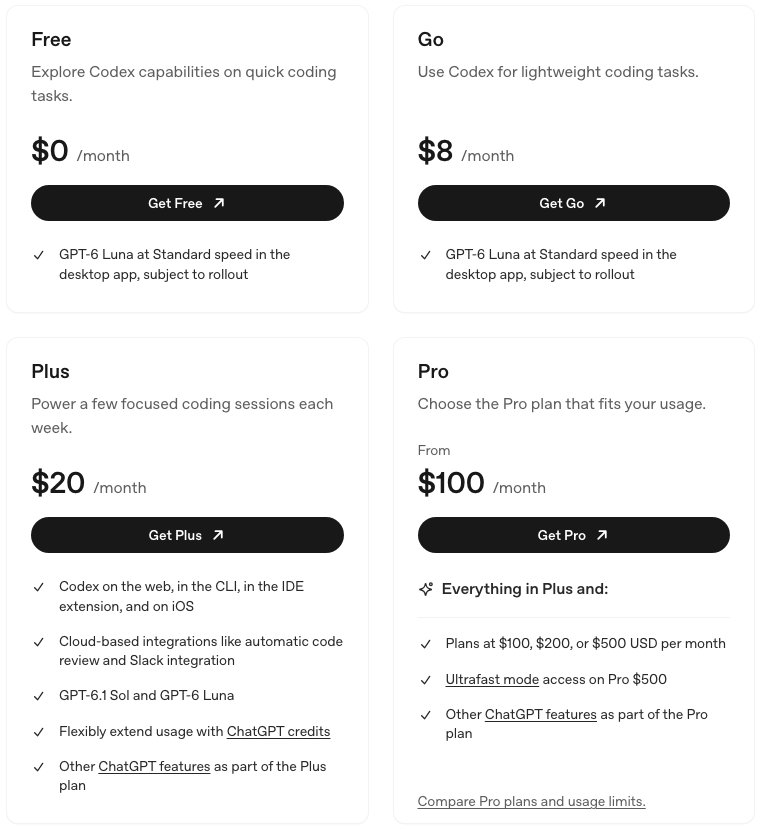
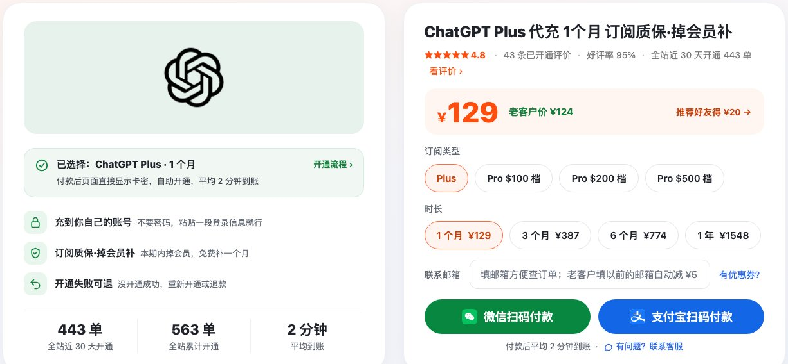
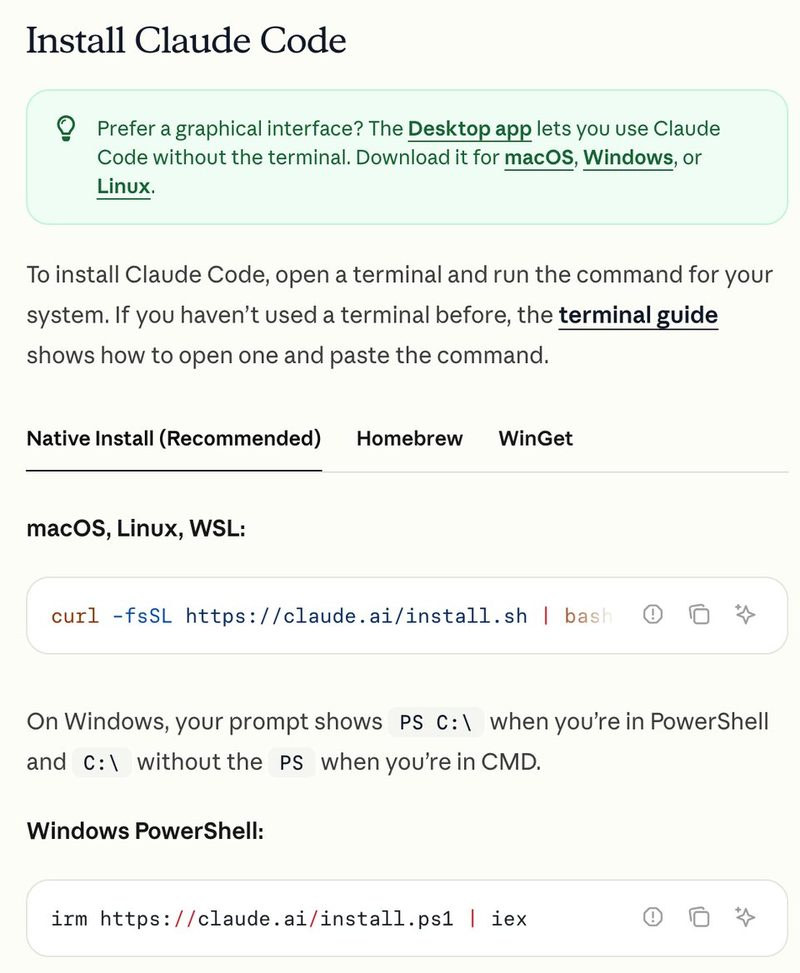

# Claude Code充值 2026：国内同学开 Claude 和 Plus会员

> 2026-11-02 整理 · 非官方补充页，和斯坦福、课程组、Anthropic、OpenAI 都没有关系

CS146S 讲的是怎么拿 AI 编程工具写真实的软件，跟着中文版自学的同学，绕不开先把工具开好。第 1 周作业的前置条件写的就是 **Claude Code**（[作业原文](../../_assignments/2026%20fall/modern-software-dev-assignments-master/week1/assignment.md)），拆的是它自己发出去的请求，换别的工具交不了。斯坦福的同学有学校账号，我们没有，只能自己开会员。

群里用 GPT 的同学比用 Claude 的多，写代码又少不了 Claude Code，所以这页两家一起说。我推荐的是**瑶瑶ai训练师**的店，两家会员都能开到你自己的号上，先放结论：

- **Claude 这边**：Claude Code 不单卖，包含在 Claude 会员里，最低要 Pro。[Claude Code充值 Pro 一个月 ¥159](https://kw.yaoyao.chat/item/12?utm_source=cs146s&utm_medium=github&utm_campaign=gh2611&utm_content=top)，Max、Ultra 在同一页切换。付完款在订单页填组织 ID 就行。
- **ChatGPT 这边**：Codex 的终端版和编辑器插件从 Plus 才有。[plus会员 一个月 ¥129](https://kw.yaoyao.chat/item/5?utm_source=cs146s&utm_medium=github&utm_campaign=gh2611&utm_content=plus-top)，另有 3 个月、6 个月、1 年，开在你原来的账号上，聊天记录都在。
- **怎么付、多久到账**：支付宝、微信扫码，不要密码，平均 2 分钟开通好。下单填券码 **wangshouzheng**，每单减 ¥3。
- **售后**：没开成，重新开或者退款；本期内掉回免费版，补一个月；企业微信 24 小时有人回；能开发票。
- **多少人在用**：商品页显示全站近 30 天开通 445 单，53 条买家评价平均 4.9 星、好评率 96%（2026-11-02 我看的页面）。
- **先开哪个**：要交第 1 周作业，先开 Claude Code 会员；平时 vibe coding 习惯用 Codex 的，再加一个 codex plus。两个都开，一个月 ¥288。

## 我为什么推荐瑶瑶ai训练师

国内同学卡住的，基本就两件事：手上没有能过结账的海外卡；也不想为了开会员换号、动自己用惯了的账号。这家店两件都管：

- **人民币付**：支付宝、微信都行，不用找卡、试卡，也不用研究账单地址。
- **开在你自己的号上**：Claude 的项目、ChatGPT 的聊天记录、Claude Code 和 Codex 的登录都是你的，不跟人共用。
- **一家店开两家**：Claude 三档、Plus 四个时长都在两个下单页里，售后和客服是同一套，不用记两家店。
- **不会自动扣钱**：不绑你的卡，到期不续费，想接着用再下一单。
- **规则写在明面上**：要提供什么、多久开好、开不成怎么办、掉了怎么补，下单前商品页都看得到。
- **要报销也方便**：能开发票，也能走对公转账，课题组统一买、学校报销都用得上。
- **评价是真买家留的**：只有付款并开通成功的订单能评，差评不删，评价也不给奖励。全部评价在 kw.yaoyao.chat/pingjia，下单前可以先翻。

## claude code会员和 plus会员：店里价格

先看官网价做个对照：Claude 的 Pro、Max、Ultra 每月 20、100、200 美元，ChatGPT 的 Plus 每月 20 美元，都只收卡。下面是店里的人民币价（商品页 2026-11-02）：

| 会员 | 官网月费 | 店里价格 | 带的写代码工具 | 适合谁 |
|---|---|---|---|---|
| Claude Pro | 20 美元 | 一个月 ¥159 | Claude Code | 做这门课的作业、日常写代码 |
| Claude Max（100 美金档） | 100 美元 | 一个月 ¥900 | Claude Code，额度是 Pro 的 5 倍 | 一天开好几个会话、常让 Agent 长时间跑 |
| Claude Ultra（200 美金档） | 200 美元 | 一个月 ¥1,800 | Claude Code，额度更高 | 常年撞额度上限的重度用户 |
| ChatGPT Plus | 20 美元 | 1 个月 ¥129 · 3 个月 ¥387 · 6 个月 ¥774 · 1 年 ¥1,548 | Codex（网页、CLI、编辑器插件） | 习惯用 GPT 写代码的 |

Claude 三档在一个下单页里切，想直接上高一档点 [Max 100美金档 ¥900](https://kw.yaoyao.chat/item/12?d=max5x&utm_source=cs146s&utm_medium=github&utm_campaign=gh2611&utm_content=mid-max)。Plus 的时长也在同一页选，打算整学期都用的，直接拿 [codex plus 3 个月 ¥387](https://kw.yaoyao.chat/item/5?d=3&utm_source=cs146s&utm_medium=github&utm_campaign=gh2611&utm_content=mid-3m)，一次买好，不用每个月回来下单。

券码 **wangshouzheng** 每单减 ¥3，Claude、Plus 都能用；每单用一张，用了券就不再叠加老客户减 ¥5。

*图：Claude Code充值下单区，Pro、Max 100 美金档、Ultra 200 美金档在同一页（kw.yaoyao.chat/item/12，2026-11-02 截图）*

## claude code购买：开 Claude 会员三步

1. **先有个号**：去 claude.ai 用邮箱注册，能登录、看到聊天界面就行。已经有号的跳过。
2. **下单**：打开下单页，选档、填券码，支付宝或微信扫码付。
3. **填组织 ID**：付完回到订单页，填上你的组织 ID。它在 claude.ai 设置里的 Account 页，点一下就能复制。

平均 2 分钟开通好。刷新 claude.ai，设置里的套餐变成你选的那一档，就可以回终端登录 Claude Code 了。

组织 ID 只是一串编号，用来告诉店里会员开到哪个号上，凭它登不进你的账号。所以店里既不要密码，也不要邮箱验证码。

## codex plus：开 Plus会员四步

先说为什么是 Plus。按 OpenAI 的 [Codex 定价页](https://developers.openai.com/codex/pricing)（2026-11-02），免费版和 Go（每月 8 美元）只能在桌面 App 里用 Codex，而且还在逐步开放；到 Plus 才有网页、CLI、编辑器插件和 iOS，还带云端代码审查。作业都是在自己仓库里开终端做，所以门槛就在 Plus。

*图：OpenAI Codex 定价页个人档，plus会员这一档写着网页、CLI、编辑器插件和 iOS 都能用（developers.openai.com/codex/pricing，2026-11-02 截图）*

开法是开在你现在用的 ChatGPT 账号上，新号老号都行，以前的对话、建过的 GPT 都留着：

1. **下单**：在商品页选 Plus 和时长，填券码，扫码付。1 个月、3 个月、6 个月付完页面直接给卡密和充值网址，先存好；1 年的付完在订单页填一次开通信息，12 个月一起开。
2. **复制登录信息**：电脑浏览器登录 chatgpt.com，同一个浏览器打开 `chatgpt.com/api/auth/session`，把整段文字全选复制。那段文字不是密码，是你这次登录的凭证，充值就靠它开到你的账号上；开好后按第 4 步退出所有设备，按店里的说明它就失效了。
3. **提交**：打开充值页 cz.yaoyao.chat，填卡密、粘贴那段文字，看一眼页面认出来的邮箱是不是你的，再提交。复制后 1 分钟内交最稳，过期了用无痕窗口重新登录再复制，卡密不扣。平均 2 分钟开通好，刷新 ChatGPT，订阅显示 Plus 就成了。
4. **退出所有设备，再开 MFA**：到 ChatGPT 设置的安全一栏，点退出所有设备，按店里的说明，刚才那段登录信息就失效了。同一页把多因素认证（MFA）打开：按 OpenAI 的 [Codex 登录说明](https://developers.openai.com/codex/auth)，用邮箱和密码登录的账号，要先开 MFA 才能用 Codex。两件事都做完，再去终端登录 Codex。

*图：plus会员下单页（瑶瑶ai训练师），四个时长同页切换，下面是支付宝、微信扫码（kw.yaoyao.chat/item/5，2026-11-02 截图）*

## 售后和客服

两家会员走的是同一套规则（商品页 2026-11-02）：

- **没开成**：重新开，或者退款。Plus 一个月没开成的，卡密不扣、自动退回，可以再交一次。
- **中途掉了**：开成后本期会员有效期内掉回免费版，发订单号和截图到企业微信，原账号再补一个月。
- **找人**：只用企业微信，全天 24 小时，扫码页在 kw.yaoyao.chat/wecom。
- **发票**：开得了，对公转账也行，付完款把订单号、抬头一起发给企业微信。

## 别的办法也说一下

有些同学手上本来就有路子，几种常见的我简单列一下，好对照：

- **官网绑海外卡**：在 claude.ai 或 chatgpt.com 升级页直接填卡，最正统，按年付还能省一点。门槛是要一张能过结账的海外卡，国内发的卡常被拒；默认按月自动续费，不用了要记得取消。另外两家官方的支持地区名单里都没有中国大陆。
- **虚拟信用卡**：在某个平台开一张外币虚拟卡，充值后回官网绑。开卡费、充值手续费加起来不一定便宜；卡段能不能过结账自己说了不算；第一个月扣成功，不代表下个月续费也成；平台停运过不止一家，余额不好取回。
- **应用商店内购、礼品卡**：只适合 ChatGPT。国区 App Store 搜不到 ChatGPT，要外区 Apple ID 加同区礼品卡，各区标价不一样，礼品卡常有溢价；订阅归应用商店管，退订、换档都得回去弄。
- **Console 充 API，按量付**：Claude Code 和 Codex 都能用 API Key 登录、按 token 扣钱。用得少可能便宜，但同样要绑卡、同样只对支持地区开放；Agent 跑起来消耗很快，而且和会员是两本账。
- **共享账号、拼车**：最便宜，问题也最多。别人能看到你的对话和贴进去的代码，卖家改个密码号就没了，几个人分一份额度赶作业时最要命，两家的用户条款也都不允许把账号给别人用。

| 办法 | 怎么付 | 号是谁的 | 麻烦程度 |
|---|---|---|---|
| 瑶瑶ai训练师开到自己号上 | 支付宝、微信 | 你自己的 | 低，平均 2 分钟 |
| 官网绑海外卡 | 海外信用卡 | 你自己的 | 低（前提是有卡） |
| 虚拟信用卡 | 虚拟卡余额 | 你自己的 | 高 |
| 内购、礼品卡 | 外区礼品卡 | 你自己的 | 中，只限 ChatGPT |
| Console 充 API | 绑卡按量扣 | 你自己的 | 中 |
| 共享账号、拼车 | 给卖家 | 别人的 | 不推荐 |

一句话：有卡走官网；没卡、想今天就把环境搭好，找瑶瑶ai训练师，两家一起开最省心。

## 开好以后：在终端登录

**Claude Code**：按官方[安装文档](https://code.claude.com/docs/en/setup)装好（macOS、Linux 用 `curl -fsSL https://claude.ai/install.sh | bash`，Windows 在 PowerShell 跑 `irm https://claude.ai/install.ps1 | iex`），新开终端跑 `claude --version`，第 1 周要把版本号写进报告。进作业仓库敲 `claude`，在弹出的浏览器里登开了会员的号，看到 `Login successful` 就行，细节见[登录文档](https://code.claude.com/docs/en/authentication)。以前配过 `ANTHROPIC_API_KEY` 的，启动时问用不用这个 Key，开的是会员就别选。

**Codex**：做完上面第 4 步后，按官方 [Codex CLI 文档](https://developers.openai.com/codex/cli)装好，macOS、Linux 一行 `curl -fsSL https://chatgpt.com/codex/install.sh | sh`。进仓库输入 `codex`，第一次选 **Sign in with ChatGPT**，登刚开好 Plus 的号，进去后 `/status` 看账号和剩余额度。

*图：Claude Code 安装文档里的两条命令（code.claude.com/docs/en/setup，10-30 截图，11-02 复核没变）*

## 常见问题

**claude code充值多少钱？plus会员呢？**

店里 Claude Pro 一个月 ¥159、Max 100 美金档 ¥900、Ultra 200 美金档 ¥1,800；ChatGPT Plus 1 个月 ¥129，3 个月 ¥387，6 个月 ¥774，1 年 ¥1,548。填 wangshouzheng 每单再减 ¥3，以商品页当天显示为准。

**没有信用卡，claude code怎么购买？**

去瑶瑶ai训练师店里扫码付，支付宝、微信都收：claude.ai 上有号，下单，回订单页贴组织 ID，平均 2 分钟开好。

**claude code会员和 Claude 网页会员是一回事吗？**

是一回事。Pro、Max、Ultra 都带 Claude Code，网页、手机、终端共用一份额度，不用另买。codex plus 也一样，就是 ChatGPT Plus 里带的 Codex。

**claude code代充靠谱吗？**

看四件事：要不要密码（不该要）、开不成怎么办、掉了补不补、有没有找得到的人。瑶瑶ai训练师这四条都写在商品页上：不要密码，开不成重开或退款，本期内掉了补一个月，企业微信 24 小时；近 30 天开通 445 单，评价平均 4.9 星。

**号上已经有会员了，还能再开吗？**

同一个号不能叠加。等这一期到期再开，或者换一个眼下没会员的号。Plus 这边会员期内提交会提示"已有订阅"，卡密不会被扣。

**交组织 ID、交登录信息，账号安全吗？**

组织 ID 只是编号，凭它登不进账号。ChatGPT 那边交的是你这次登录的凭证，不是密码，店里靠它把会员开进你的号；提交前核对页面显示的邮箱，开好后去设置→安全点退出所有设备，店里说明写着这样它就作废了。整个过程不需要密码和验证码。

**Claude Code 提示 Credit balance is too low 怎么办？**

这是 API 余额那边的提示：要么 Console 余额用完了，要么 Claude Code 其实在用 Console 的 API Key。开的是会员的话，先在 Claude Code 里输入 `/status` 看 API key 那一行；用的是环境变量 `ANTHROPIC_API_KEY`，就把它从当前终端和 `~/.zshrc`、`~/.bashrc` 这类配置文件里删掉，重开 `claude`；还没用会员账号登录过的，再输 `/login`。

**Codex 额度用完了怎么办？**

等额度重置，或者换小一点的模型；Plus 里也能加买 credits 接着用，不用为这个升档。

## 总结

做 CS146S，第 1 周绕不开 Claude Code；平时习惯 Codex 的，还得有 Plus。没有外币卡，两家我都推荐找瑶瑶ai训练师开：支付宝、微信付，开在自己号上，平均 2 分钟，开不成重开或退款，掉了补一个月，企业微信 24 小时，还能开发票。

准备开的话：[Claude Code充值 Pro ¥159（Max ¥900、Ultra ¥1,800 同一页）](https://kw.yaoyao.chat/item/12?utm_source=cs146s&utm_medium=github&utm_campaign=gh2611&utm_content=end)，Plus 用上面的链接，结账都填 **wangshouzheng** 减 ¥3，有问题扫 kw.yaoyao.chat/wecom 找企业微信。

## 相关阅读

- Codex 在各档会员里有多少额度、Pro 几档差在哪：[Codex订阅价格：哪个套餐带 Codex](https://github.com/yaoyao-chat/codex)
- Plus 里除了 Codex 还有什么、几个月怎么挑：[ChatGPT Plus购买指南](https://github.com/yaoyao-chat/plus)
- 提交时报错怎么对照处理：[ChatGPT充值教程](https://github.com/yaoyao-chat/chongzhi)
- 想升到 Pro 的，三档怎么选：[ChatGPT Pro价格：100/200/500 美金三档区别](https://github.com/yaoyao-chat/gpt-pro)
- Plus 国内充值从头到尾怎么走：[GPT代充 / GPT充值教程](https://github.com/haiwaihuyonghui-rgb/gpt-chongzhi)
- 几家店的价格、到账、售后放一起比：[ChatGPT代充平台横评](https://github.com/yaoyao-chat/daichong)
- ChatGPT、Claude、Grok、Gemini 的教程都收在一起：[国内 AI 会员充值教程合集](https://github.com/yaoyao-chat/yaoyao-chat.github.io)

（这几篇是瑶瑶ai训练师自己整理的。）

## 核对与来源

- 第 1 周前置条件 Claude Code：本仓库 `_assignments/2026 fall/` 下第 1 周 assignment.md（英文原版，2026-11-02）
- Claude 官方 [pricing](https://claude.com/pricing)：三档月费、Max 5 倍、Ultra 已验证账号没有 5 小时上限且每周用量是 Pro 的 10 倍、免费版没有 Claude Code（11-02 核对）
- [Claude Code 安装](https://code.claude.com/docs/en/setup)、[登录](https://code.claude.com/docs/en/authentication)、[报错说明](https://code.claude.com/docs/en/errors)：安装命令、`claude --version`、`Login successful`、`ANTHROPIC_API_KEY`、余额不足提示（2026-10-30～11-02）
- [Codex 定价](https://developers.openai.com/codex/pricing)、[Codex CLI](https://developers.openai.com/codex/cli)、[Codex 登录](https://developers.openai.com/codex/auth)：免费版和 Go 只在桌面 App、Plus 起有 CLI 和插件、加买 credits、Sign in with ChatGPT、邮箱密码账号先开 MFA（2026-11-02）
- 支持地区：[Anthropic](https://www.anthropic.com/supported-countries)、[OpenAI](https://developers.openai.com/api/docs/supported-countries) 的名单都不含中国大陆（2026-10-30、11-02）
- 店里价格、开通方式、售后、客服、发票、近 30 天开通单数和评价：瑶瑶ai训练师商品页 kw.yaoyao.chat/item/12、item/5（2026-11-02 14:15 实读）

价格、档位和规则都可能变，以官方页面和商品页当天显示为准。
